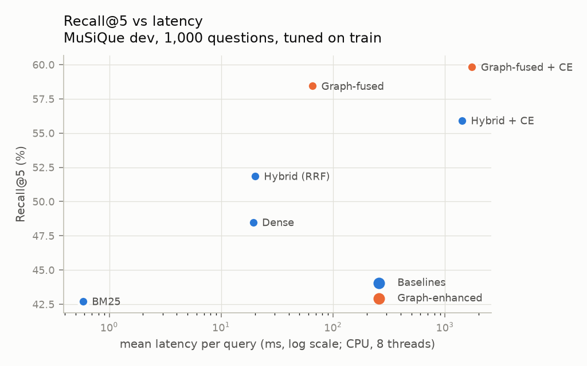

# HopGraph

**An LLM-free, CPU-first study of graph-enhanced multi-hop passage retrieval and adaptive retrieval costs.**

> On a CPU-only laptop, does an LLM-free entity graph with Personalized PageRank improve
> multi-hop passage retrieval over a properly tuned hybrid retrieval system with a
> cross-encoder reranker? And if so, can cheap features predict which queries benefit
> enough to justify the extra cost?

HopGraph is an **information-retrieval** project. It returns ranked evidence passages and
evaluates them against gold supporting passages. It does **not** generate answers.

**Status (2026-10-25): Gate 1 passed on MuSiQue; 2WikiMultiHopQA and ablations pending.**
All systems were tuned on 500 MuSiQue **train** questions and then evaluated once on 1,000
**dev** questions:

| | Recall@5 | AllGold@5 | mean latency (CPU) |
|---|---|---|---|
| Hybrid (BM25 + dense, RRF) | 51.9 | 17.0 | 20 ms |
| Hybrid + cross-encoder (top 50) | 55.9 | 20.9 | 1,416 ms |
| **Graph-fused** (+ spaCy entity graph, PPR) | **58.4** | 24.0 | **65 ms** |
| Graph-fused + cross-encoder | **59.8** | **27.0** | 1,739 ms |

The pre-registered headline, graph + cross-encoder minus hybrid + cross-encoder, is
**+3.9 Recall@5 (95% CI [+2.8, +5.0])**. Graph-fused retrieval *without* a reranker also
beats the tuned reranker pipeline (+2.5 [+1.1, +3.9]) at 1/22 of the latency, but that
comparison was not pre-registered. See [`docs/results.md`](docs/results.md), and
[`docs/day3_decision.md`](docs/day3_decision.md) for how the decision evolved from the
200-question spike. These are retrieval metrics on one dataset; answer quality was not measured.



## What is (and is not) new

Graph retrieval with Personalized PageRank (HippoRAG, HippoRAG 2), LLM-free graph RAG
(TIGRAG), routing between vanilla and graph RAG (EA-GraphRAG, R²Adapter, SkewRoute), and
retrieval-gain-labelled routers (Per-Query Gating of LLM Rerankers) are all **prior work**;
see [`docs/novelty_review.md`](docs/novelty_review.md). HopGraph's contribution is an
**engineering study**: a HippoRAG-2-style entity–passage graph built with spaCy NER instead
of an LLM, compared at retrieval level against a strong BM25 + dense + RRF + cross-encoder
baseline, with paired bootstrap intervals, per-stage latency, peak RAM and an
oracle-routing upper bound, all on a 16 GB CPU laptop.

## Systems compared

| System | Pipeline |
|---|---|
| `bm25` | bm25s (k1 = 1.5, b = 0.75, Snowball stemming, English stop words) |
| `dense` | BGE-small-en-v1.5 + FAISS `IndexFlatIP` (exact cosine) |
| `hybrid` | RRF(BM25, dense), k = 60 |
| `hybrid_ce` | hybrid → MiniLM-L6 cross-encoder over the top 20 |
| `graph_only` | link query entities → seed PPR (entities × specificity + top-5 hybrid passages) → rank passage nodes |
| `graph` | RRF(hybrid, graph_only) |
| `graph_ce` | graph → cross-encoder over the top 20 |

## Setup (Windows PowerShell, CPU only)

Tested with Python 3.12.10 on Windows 11. (The spec asked for 3.11, which is not installed
on the development machine; every dependency has native 3.12 Windows wheels.)

```powershell
py -3.12 -m venv .venv
.\.venv\Scripts\python.exe -m pip install -r requirements.lock.txt
```

The lock file pins the CPU-only PyTorch build (`--extra-index-url https://download.pytorch.org/whl/cpu`)
and the spaCy `en_core_web_sm` 3.8.0 wheel. The models download on first use: BGE-small
~127 MB, MiniLM cross-encoder ~87 MB, spaCy ~13 MB.

## Reproduce

Quick check: the Day-3 spike on 200 questions takes about 35 minutes.

```powershell
$py = ".\.venv\Scripts\python.exe"
& $py scripts\download_data.py musique_dev                        # 30 MB, SHA-256 verified
& $py scripts\tasks.py reproduce --config configs\musique_200.yaml --tag day3
& $py -m pytest -q                                                # no model downloads needed
```

Headline result: tune on train, then evaluate once on dev-1,000. Allow about 5 hours on 8
cores, most of it cross-encoder scoring.

```powershell
& $py scripts\download_data.py musique_train                      # 241 MB, SHA-256 verified
foreach ($c in "configs\musique_tune500.yaml", "configs\musique_1000.yaml") {
  & $py scripts\build_corpus.py --config $c; & $py scripts\embed.py --config $c; & $py scripts\build_graph.py --config $c
}
& $py scripts\tune.py --config configs\musique_tune500.yaml       # writes configs\frozen\musique_tune500_frozen.yaml
& $py scripts\build_bm25.py --config configs\musique_1000_tuned.yaml
& $py scripts\run_eval.py   --config configs\musique_1000_tuned.yaml --tag final
& $py scripts\make_plots.py results\<run dir>
```

`configs/musique_1000_tuned.yaml` is `musique_1000.yaml` with the frozen overrides merged in.
2WikiMultiHopQA (`configs/twowiki_1000.yaml`) needs the official `data.zip` (246 MB, linked
from the Alab-NII/2wikimultihop README); extract `data/dev.json` to `data/raw/2wiki/dev.json`.

Each run writes `results/<name>_<run_id>/` containing the exact config, Git commit,
corpus hash, environment, per-query JSONL (ranked IDs, metrics, stage timings, linking
path), metric/latency/bootstrap CSVs and `summary.json` (strongest baseline, oracle router,
linking statistics). The run ID is a hash of config + commit + data, so changing any of
them produces a new directory.

## Repository layout

```
src/hopgraph/   ingestion/  retrieval/  graph/  evaluation/  pipeline.py  config.py
scripts/        download_data, build_corpus, build_bm25, embed, build_graph, run_eval, tune, make_plots, error_analysis, tasks
configs/        one YAML per experiment (unknown keys are errors)
tests/          78 tests (incl. PPR vs NetworkX, end-to-end on a hand-labelled corpus); CI runs them without torch
docs/           results, day3_decision, tuning, novelty_review, foundations, architecture, adr/, CHECKLIST, THIRD_PARTY
```

## Data and licenses

MuSiQue (CC BY 4.0) is downloaded by script and **never committed**. Model and library
licenses are listed in [`docs/THIRD_PARTY.md`](docs/THIRD_PARTY.md).
