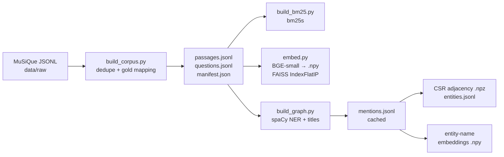
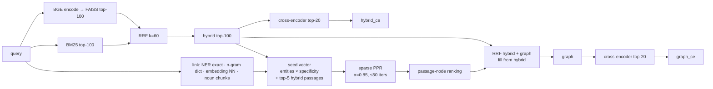

# Architecture

## Offline (index build): one script per stage, so heavy models never share a process

Every artefact directory name contains a hash of the settings that produced it
(`src/hopgraph/artifacts.py`), so a changed parameter can never silently reuse a stale index.

## Online (one query)

`Pipeline.run` (`src/hopgraph/pipeline.py`) runs every stage once per query and times
each stage with `perf_counter`. A system's latency is the sum of the stages it depends on
(`SYSTEM_STAGES`), because graph retrieval starts from the hybrid result.

## Module map

| Module | Responsibility |
|---|---|
| `types.py` | `Passage`, `Question`, `RankedList` (deterministic ID tie-break) |
| `config.py` | YAML → nested dataclasses; unknown keys and wrong types raise |
| `ingestion/` | MuSiQue loader, dedupe by content hash, fail-loud gold mapping, JSONL I/O |
| `retrieval/` | `bm25.py`, `dense.py`, `fusion.py` (RRF, fill), `rerank.py` |
| `graph/` | `entities.py` (NER, normalization), `build.py` (CSR graph), `ppr.py`, `linking.py`, `retriever.py` |
| `evaluation/` | `metrics.py`, `bootstrap.py` (+Holm), `timing.py`, `memory.py` (RSS sampler), `report.py` (tables, oracle) |
| `runinfo.py` | logging with run ID, Git commit, environment capture |

## Why there is no database, vector DB, or graph DB

The corpus at the planned scale is 3k–40k passages. A FAISS flat index (17 MB for 11.5k ×
384 float32), a bm25s sparse matrix and a SciPy CSR matrix all fit in RAM. They load in
under a second, and they make every operation inspectable and testable. A server would add
operational cost and nothing measurable.
